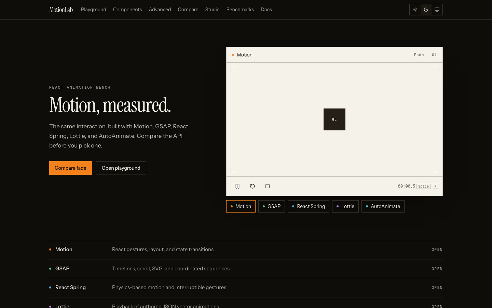
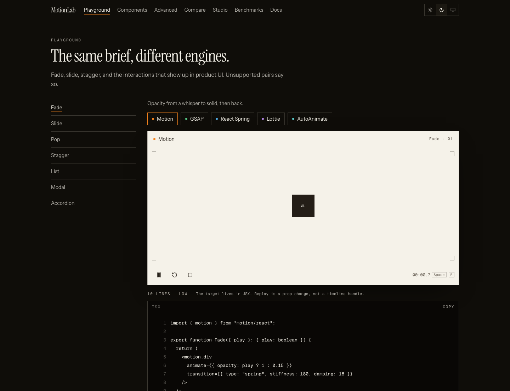
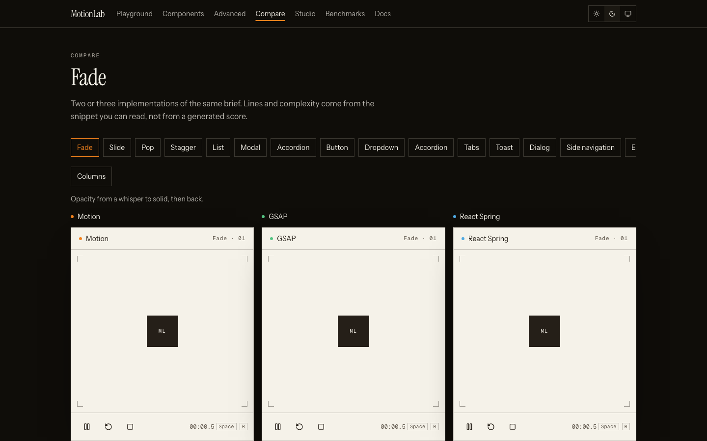
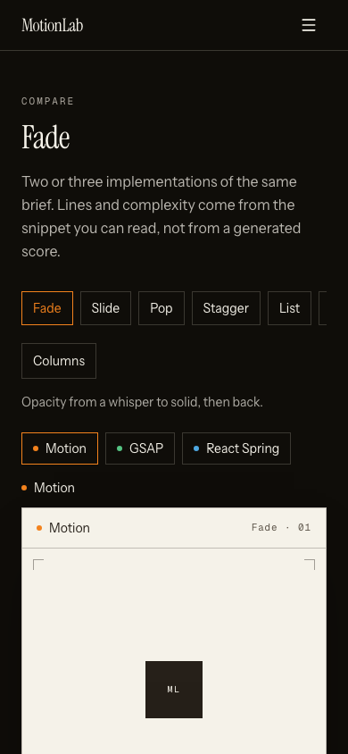
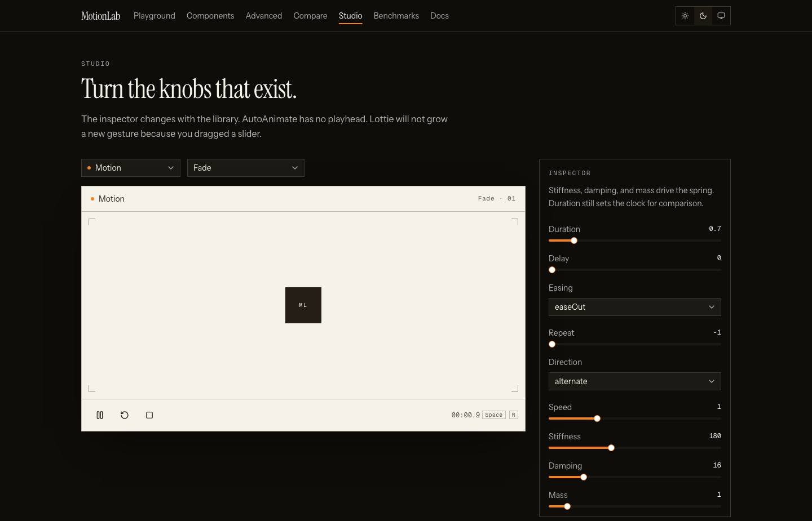
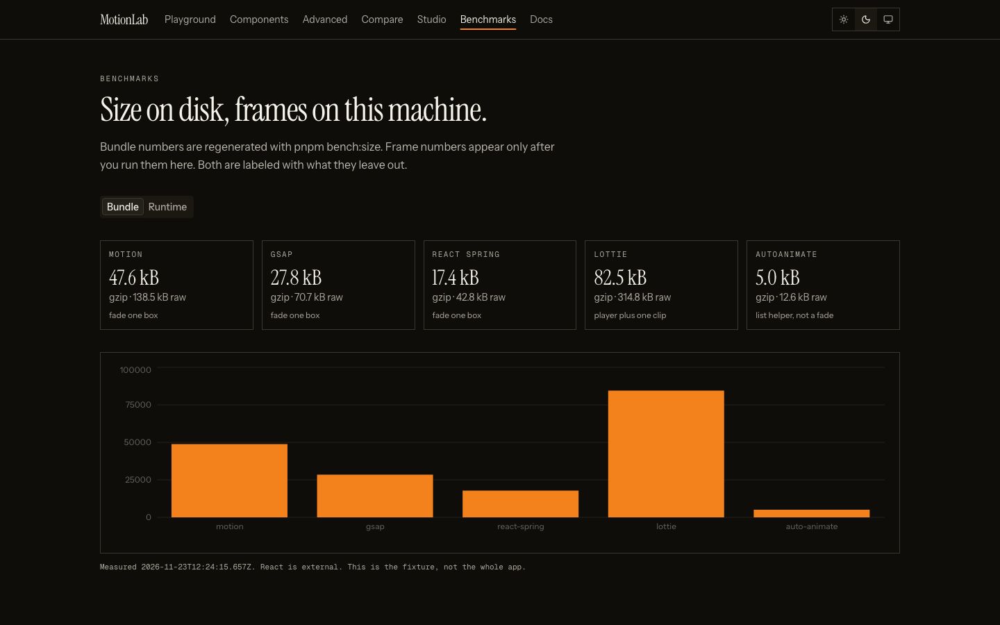

# MotionLab

MotionLab is a React animation bench. It shows Motion, GSAP, React Spring, Lottie, and AutoAnimate on the same stage, then compares the ones that can honestly do the same job.

## What you can do

- Play comparable fades, slides, staggers, lists, modals, and accordions.
- Open component demos: buttons, menus, tabs, toasts, dialogs, drawers, cards, a gallery, skeletons, and lists.
- Watch signature work: scroll, parallax, timelines, text, SVG drawing, horizontal scroll, a landing sequence, pointer follow, drag, and Lottie playback.
- Compare two or three libraries on one brief.
- Change the controls that library actually has.
- Read the notes, then run a bundle and frame check.

## Setup

```bash
pnpm install
pnpm dev
```

Open [http://localhost:3000](http://localhost:3000).

```bash
pnpm test
pnpm test:e2e
pnpm bench:size
pnpm build
```

`pnpm bench:size` rewrites `src/features/benchmarking/bundle-data.ts`. React is external. Lottie includes the player and one clip. AutoAnimate is measured as a list helper, not a fade.

## Screenshots



The paper stage sits above the fold and plays a fade on the library you pick. `/`



The fade stays on the brief, and the snippet under the stage is the implementation you can read. `/playground/motion/fade`



Three fades of the same brief, side by side, after each stage has loaded. `/compare/fade`



At 390px the same compare becomes a library switcher and one stage. `/compare/fade`



The inspector shows the controls that library has. `/studio`



Gzip sizes for one fade fixture, labeled with what each number leaves out. `/benchmarks`

## Routes

- `/` home
- `/playground` and `/playground/[library]/[scenario]`
- `/components` and `/components/[slug]`
- `/advanced` and `/advanced/[slug]`
- `/compare` and `/compare/[scenario]`
- `/studio`
- `/benchmarks`
- `/docs` and `/docs/[slug]`

## Docs

In the app, at `/docs`: how to use the bench, one page per library, how to choose, what the numbers mean, and how animation sits in React.

Repo notes:

- [TECH_STACK.md](TECH_STACK.md)
- [ARCHITECTURE.md](ARCHITECTURE.md)
- [ANIMATION_LIBRARIES.md](ANIMATION_LIBRARIES.md)
- [IMPLEMENTATION_GUIDE.md](IMPLEMENTATION_GUIDE.md)
- [BENCHMARKS.md](BENCHMARKS.md)
- [DECISIONS.md](DECISIONS.md)
- [TESTING.md](TESTING.md)

Interview notes, separate from the product docs:

- [INTERVIEW_PREP.md](INTERVIEW_PREP.md)
